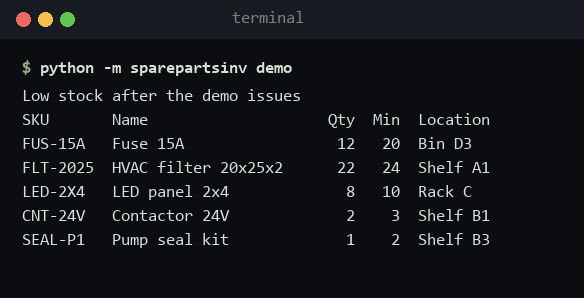

# spare-parts-inventory-cli

A storeroom needs to know three things: what is on the shelf, what was taken and when, and what to reorder. This command line tool keeps spare parts in one SQLite file, logs every movement and lists the parts that are at or below their minimum.



## What it is for

Maintenance storerooms often run on a spreadsheet that nobody trusts. Technicians take a belt or a filter, nobody writes it down, and the part is missing when a unit fails. A storeroom keeper, facility coordinator or maintenance lead can use this tool to receive and issue parts, see the history of any part, and print a low stock list before ordering.

## Install

```
git clone https://github.com/yassine2med/spare-parts-inventory-cli
cd spare-parts-inventory-cli && pip install -r requirements.txt
```

## How to use

| I want to | Command |
|---|---|
| Try it with sample data (nothing is saved) | `PYTHONPATH=src python -m sparepartsinv demo` |
| Load parts from a CSV file | `PYTHONPATH=src python -m sparepartsinv import data/parts.csv` |
| Add one part | `PYTHONPATH=src python -m sparepartsinv add FUS-20A "Fuse 20A" --qty 10 --min 5 --location "Bin D4"` |
| Receive stock | `PYTHONPATH=src python -m sparepartsinv receive BLT-A42 6 --note "PO delivery"` |
| Issue stock | `PYTHONPATH=src python -m sparepartsinv issue BLT-A42 2 --note "belt swap"` |
| List every part | `PYTHONPATH=src python -m sparepartsinv list` |
| List parts at or below minimum | `PYTHONPATH=src python -m sparepartsinv low` |
| Show the movements of one part | `PYTHONPATH=src python -m sparepartsinv history BLT-A42` |
| Use another database file | add `--db FILE` before the command (default `inventory.db`) |
| Show help | `PYTHONPATH=src python -m sparepartsinv --help` |

The CSV has the columns `sku,name,quantity,min_qty,location` (see `data/parts.csv`). Exit codes: 0 on success, 1 on a stock error such as an unknown SKU or issuing more than is in stock, 2 on bad arguments.

Example:

```
PYTHONPATH=src python -m sparepartsinv demo
```

Output:

```
Low stock after the demo issues
SKU       Name                    Qty  Min  Location
FUS-15A   Fuse 15A                 12   20  Bin D3
FLT-2025  HVAC filter 20x25x2      22   24  Shelf A1
LED-2X4   LED panel 2x4             8   10  Rack C
CNT-24V   Contactor 24V             2    3  Shelf B1
SEAL-P1   Pump seal kit             1    2  Shelf B3
```

Issuing more than is in stock is refused and nothing changes:

```
error: only 2 of CNT-24V in stock, cannot issue 5
```

Run the tests with `python -m pytest -q`.

## How it works

1. Parts live in one SQLite table, movements in a second table with a timestamp and a note.
2. `receive` and `issue` change the quantity and write a movement in one transaction.
3. An issue that would take stock below zero is rejected.
4. `low` returns parts where quantity is less than or equal to the minimum.

## Limits

- One storeroom, one location per part. No purchase orders, no prices, no users.
- Nobody is recorded as the person who took a part, only the note you type.
- The database file is not locked for several people writing at once.

## License

MIT. Yassine Emhamed, 2026.
